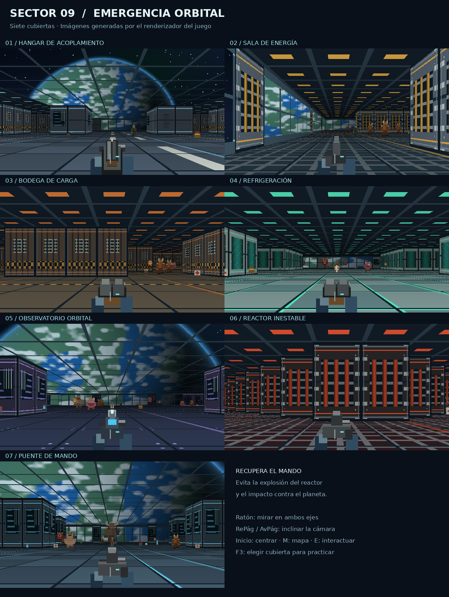
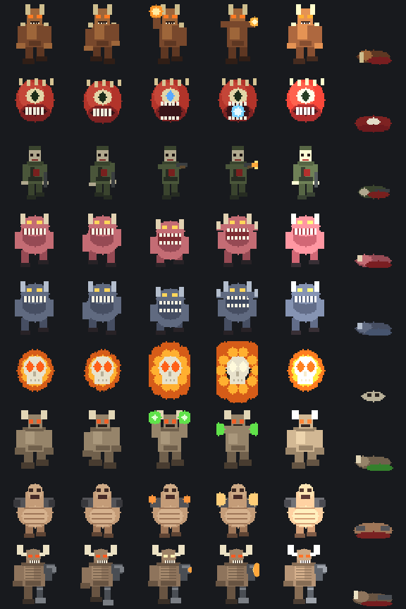
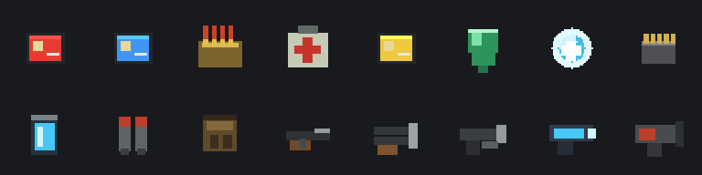
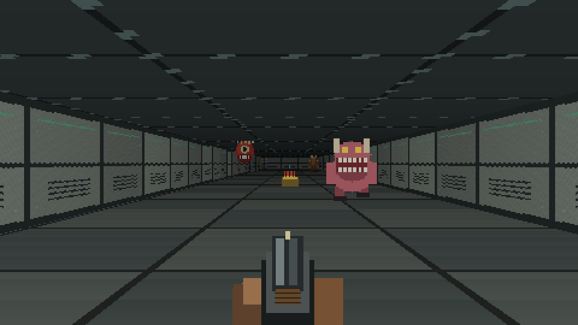

# Sector 09

Juego académico de disparos en primera persona en C#, inspirado en los FPS clásicos. La nave Sector 09 tiene el reactor averiado y cae hacia un planeta: hay que estabilizar sus sistemas, expulsar el reactor dañado y recuperar el timón antes del impacto. Se construyó sobre **DoomFPS_Solution_Capas.zip** y conserva sus entidades, servicios, interfaz de repositorio, implementación en memoria y pruebas originales. Ahora es una **campaña de siete misiones con objetivos diferentes**, seis armas, nueve especies de enemigos, modo práctica y casos ejecutables de humo y aceptación.



## Actualización espacial

- Siete planos de nave nuevos, con corredores, contenedores, tanques, un observatorio circular, un reactor octogonal y un puente de mando.
- Ventanales sólidos, estrellas, nebulosa y un planeta con océanos, continentes, nubes y atmósfera. Su tamaño aparente aumenta de una cubierta a otra.
- Texturas de metal, conductos, pantallas, iluminación de techo y bandas luminosas; resolución interna de 640 × 360, con estética retro.
- Ratón horizontal y vertical, giro completo a los lados e inclinación de hasta 55° hacia arriba y abajo. RePág/AvPág también inclinan la vista; Inicio la centra.
- La inclinación afecta a balas, perdigones y proyectiles. El techo y el suelo interceptan los disparos; mirar por encima del enemigo puede hacer que falles.
- Puente de mando con 300 segundos para derrotar al jefe y alcanzar el timón. Si llegas a tiempo, corriges la trayectoria y salvas la nave.

## Despliegue (escritorio y web con Docker)

Consulta **[DESPLIEGUE.md](DESPLIEGUE.md)**. En resumen:

- **Escritorio:** `Compilar_y_jugar.bat` (con el SDK) o `Compilar_escritorio_con_Docker.bat` (solo con Docker). Después, `Jugar.bat`.
- **Web:** `Web_Docker.bat` o `docker compose up -d --build`, y abre http://localhost:8080. El proyecto `DoomFPS.Web` ejecuta el mismo juego en el navegador con Blazor WebAssembly.

## Jugar en Windows

1. Extrae **todo** el ZIP en una carpeta.
2. Abre `Jugar.bat`. Incluye los ensamblados compilados; requiere Windows con .NET Desktop Runtime 8 o posterior.
3. Pulsa Enter para la campaña o **F3 para practicar un nivel concreto**. En práctica, elige del 1 al 7 y pulsa Enter.
4. Para recompilar después de editar, usa `Compilar_y_jugar.bat` con el SDK de .NET 8 o posterior.

Para exponer las pruebas, abre **`Casos_practicos.bat`**: permite ejecutar humo, aceptación, consultar la guía y abrir el juego. Las pruebas requieren el SDK y restaurar los paquetes NuGet.

Si Windows indica que falta `Microsoft.WindowsDesktop.App`, instala el **.NET Desktop Runtime** correspondiente desde el sitio oficial de Microsoft. Instalar solamente el runtime de ASP.NET no aporta Windows Forms. No necesita Unity, archivos WAD ni recursos de Doom.

## Abrir y modificar en VS Code

Abre en VS Code la carpeta que contiene `DoomFPS.sln`. En la terminal:

```powershell
dotnet run --project .\DoomFPS.Presentation\DoomFPS.Presentation.csproj
```

Para ejecutar las pruebas:

```powershell
dotnet test .\DoomFPS.Tests\DoomFPS.Tests.csproj
```

`Ejecutar_pruebas.bat` hace lo mismo y deja el resultado visible. La primera compilación/restauración necesita Internet para bajar los paquetes de prueba. En Visual Studio, abre `DoomFPS.sln` y selecciona `DoomFPS.Presentation` como proyecto de inicio.

## La campaña

Eres el único que respondió a la señal de auxilio del Sector 09. Conservas salud, armadura, armas, mochila y munición entre misiones, con reabastecimiento al avanzar. Reintentar restaura el equipo del inicio de esa misión y reinicia sus objetivos.

| Nivel | Mecánica para avanzar |
|---|---|
| 1 · Hangar de acoplamiento | Activa dos relés con E y llega a la salida; no hace falta eliminar a todos. |
| 2 · Sala de energía | Cruza las franjas eléctricas entre pulsos y activa tres interruptores en orden. El último desconecta la corriente. |
| 3 · Bodega de carga | Escolta al dron hasta la salida. Se detiene si te alejas o hay enemigos cerca. |
| 4 · Refrigeración | Cierra tres válvulas en 240 segundos para contener la fuga de refrigerante y evitar la explosión. |
| 5 · Observatorio orbital | Envía la nueva trayectoria orbital: defiende la antena durante 18 segundos acumulados, sin enemigos en la zona. |
| 6 · Reactor inestable | Coloca tres cargas para expulsar el reactor. La última inicia 60 segundos de evacuación. |
| 7 · Puente de mando | Desactiva tres pilones, derrota al jefe y alcanza el timón en 300 s para evitar el choque contra el planeta. |

El HUD muestra el objetivo y su progreso. **M** permite localizar los objetivos numerados; la salida cambia a verde cuando está habilitada. Las consolas activadas se vuelven verdes. En esta campaña se retiró la búsqueda repetida de tarjetas; las puertas y llaves del nivel original siguen disponibles para sus pruebas.

La práctica inicia cualquier misión en Recluta con equipo apropiado para demostrarla. Conserva el daño y los requisitos: no es un modo invulnerable. Al terminarla, concluye la práctica.

### Dificultad

| Nivel | Vida enemiga | Daño enemigo | Velocidad | Suministros |
|---|---|---|---|---|
| Recluta | ×0,75 | ×0,60 | ×0,90 | ×1,45 |
| Veterano | ×1,00 | ×1,00 | ×1,00 | ×1,00 |
| Pesadilla | ×1,40 | ×1,55 | ×1,18 | ×0,70 |

## Controles

| Tecla / acción | Función |
|---|---|
| Enter | Iniciar, continuar, desplegar o pasar de misión |
| ↑ ↓ en el menú | Elegir dificultad / opción |
| W / S | Avanzar / retroceder |
| A / D | Desplazarse lateralmente |
| Flechas izquierda / derecha | Girar la vista |
| Ctrl / clic izquierdo | Disparar |
| Espacio | Saltar |
| **R, jugando** | Recargar el arma actual (cargador + reserva) |
| **1 … 6** | Elegir arma por ranura |
| **Rueda del ratón, Q o Tab** | Arma anterior / siguiente |
| Clic izquierdo | Capturar el ratón y disparar |
| Mover el ratón capturado | Mirar a los lados, arriba y abajo |
| RePág / AvPág | Inclinar la cámara hacia arriba / abajo |
| Inicio (Home) | Centrar la inclinación vertical |
| Shift | Correr |
| E | Interactuar con el objetivo cercano que estás mirando o abrir una compuerta |
| F3, en inicio | Seleccionar un nivel en modo práctica (bloqueado para un jugador normal hasta que complete la campaña una vez; el administrador siempre puede) |
| F4, en inicio | Ver tu historial: rol, campañas completadas, mejor puntuación, tiempo jugado |
| F5, en inicio | Ver la lista de jugadores locales de este equipo |
| F6, en inicio | Panel de administrador (solo para el perfil "admin") |
| F7, en inicio | Cambiar de perfil sin cerrar el juego |
| M | Mostrar / ocultar mapa; el juego sigue activo |
| Esc | Pausar / continuar y liberar el cursor |
| ↑ ↓ / Enter, en pausa | Elegir una opción del menú de pausa (reanudar, configuración, reiniciar, guardar y salir) |
| F1 | Ver controles con el juego pausado |
| F2 | Activar / desactivar sonidos |
| R, en pausa o tras morir | Reiniciar la misión actual |

Al cambiar a otra ventana, la partida se pausa y libera el ratón. Se puede jugar enteramente con teclado. La vista usa raycasting 2.5D con inclinación vertical; no hay salto ni vuelo libre. Mirar hacia arriba no desplaza al jugador del suelo.

**Todos los menús también se manejan con el ratón**, no solo con teclado: elegir o crear perfil, continuar partida guardada o empezar de nuevo, dificultad, práctica, panel de administrador, menú de pausa y configuración (sensibilidad, subtítulos, sonido) responden al clic sobre cada fila, además de a las flechas y Enter/Esc de siempre.

## Cinemáticas, interruptores y voz de alerta

Al empezar una campaña nueva y cada vez que se completa una misión, aparece una breve escena cinematográfica (barras de cine, texto centrado con fundido de entrada) que recapitula lo que acaba de pasar y presenta la misión siguiente, usando el mismo texto narrativo de la campaña (el resumen de la misión completada y la primera línea de la nueva). Se avanza con ENTER o clic y se puede saltar entera con ESC. No aparece al reintentar una misión, al practicar (F3) ni al reanudar una partida guardada, para no repetirla de más.

El interruptor de las misiones de tipo "cruza la red eléctrica" ahora se dibuja como un panel de pared con palanca y luz de estado, en vez de un simple bloque de color.

Una voz femenina avisa en voz alta cuando la salud cae a estado crítico y cuando se consigue una mejora real (arma nueva, armadura, megaesfera o mochila); recoger munición suelta no la activa, para no saturar. Parte de una voz del sistema, pero no suena a locutor de Windows: se le aplica el mismo tipo de proceso con el que el juego genera sus propios sonidos (nada de archivos externos), con una ligera modulación en anillo, un eco metálico corto y el tono más agudo, para que suene a inteligencia artificial de nave, no a una lectura de texto genérica. Se silencia junto con el sonido normal (F2, o la fila "SONIDO" del menú de pausa). Si el equipo no tiene ninguna voz instalada, el juego sigue funcionando en silencio sin fallar.

Ahora también se puede saltar con **Espacio** (la puntería pasó a Ctrl / clic izquierdo). Es un salto visual —este mundo no tiene obstáculos con altura que sortear— pero desplaza de verdad la cámara y el arma en un arco, con su propio sonido de salto y de aterrizaje.

## Cómo están armadas las siete cubiertas

Cada cubierta ya no es un rectángulo abierto con algunos bloques sueltos: se arma como los cuartos de una casa. Se llega por un cuarto de entrada —la zona segura real: un cuarto completo donde nunca aparece un enemigo, no solo unos segundos de gracia al desplegar— y desde ahí los pasillos llevan a los cuartos siguientes, cada vez más adentro, hasta la salida. Algunas cubiertas encierran un cuarto pequeño dentro de uno grande con una sola puerta (el hangar y el observatorio tienen cada uno un cuartito así, como el baño dentro de una habitación). El casco acristalado también varía: el hangar, la bodega, el observatorio y el puente tienen bastantes ventanales al espacio, mientras que la sala de energía, refrigeración y el reactor son cubiertas casi completamente cerradas, con apenas un par de mirillas.

## Perfiles locales, guardado y progreso

No hay correo ni contraseña: al pulsar Enter en el menú se elige o crea un perfil local (como una cuenta local de Xbox 360), solo con un nombre de usuario. El perfil llamado **"admin"** (sin distinguir mayúsculas) es siempre administrador; el resto son jugadores normales. F7 permite cambiar de perfil sin reiniciar el juego, y el juego recuerda el último perfil usado.

Diferencias entre roles:

- **Jugador**: puede jugar la campaña desde el principio, pero solo puede elegir una misión suelta en modo práctica (F3) después de completar la campaña completa al menos una vez.
- **Administrador**: puede entrar a modo práctica y elegir cualquier misión en cualquier momento, y tiene acceso al panel de administrador (F6) para revisar todos los perfiles locales, reiniciar el progreso de cualquiera o eliminarlo.

Cada vez que se completa una misión (o se guarda al salir desde el menú de pausa) el progreso se guarda en el perfil, en un archivo JSON dentro de la carpeta de datos del usuario. Al volver a entrar con ese perfil, el menú principal ofrece **reanudar la partida guardada** (vuelve a la misión donde se dejó, con el equipo de ese punto de control) o **empezar una campaña nueva**. F5 muestra la lista de todos los jugadores locales con su rol, campañas completadas, mejor puntuación y última partida — visible para cualquier perfil, no solo el administrador.

## Zona segura, subtítulos y munición

Cada vez que empieza una misión nueva el jugador aparece en una **zona segura**: durante unos segundos los enemigos cercanos no se alertan, para no aparecer en mitad de un tiroteo. Un indicador "ZONA SEGURA" se muestra en el HUD mientras dura.

Un canal de **subtítulos** (sin voces) narra lo que pasa en la misión: el aviso de despliegue al empezar, el aviso cuando el objetivo se cumple, alertas de salud crítica y las fases del Ciberdemonio. Se pueden activar o desactivar desde el menú de pausa → Configuración.

Las armas usan **cargador y reserva**: el HUD muestra `cargador/reserva` (por ejemplo `8/34`) y la tecla **R** recarga manualmente con una breve animación de progreso; si el cargador se vacía disparando, se recarga automáticamente si queda reserva. La pistola de servicio, escopeta, ametralladora, fusil de plasma y lanzacohetes tienen cargadores de tamaño distinto (la escopeta de dos cañones, por ejemplo, se recarga cada dos disparos).

## Arsenal

| Ranura | Arma | Munición | Daño | Cadencia | Notas |
|---|---|---|---|---|---|
| 1 | Pistola de servicio | Balas | 13 | 13 pasos | Arma inicial, precisa |
| 2 | Escopeta de combate | Cartuchos | 8 × 8 perdigones | 30 pasos | Dispersión media |
| 3 | Escopeta de dos cañones | Cartuchos ×2 | 9 × 16 perdigones | 55 pasos | Devastadora de cerca |
| 4 | Ametralladora pesada | Balas | 8 | 4 pasos | Fuego sostenido |
| 5 | Fusil de plasma | Celdas | 20 | 6 pasos | Proyectil, atraviesa distancias |
| 6 | Lanzacohetes | Cohetes | 55 + 85 de área | 48 pasos | Radio de 3 casillas, también te daña |

Un «paso» es un ciclo de simulación; el juego corre a 60 pasos por segundo.

## Bestiario



Cada fila es una especie; las columnas son sus poses: caminar (dos cuadros), preparar el ataque, atacar, recibir daño y caer.

| Especie | Vida | Movimiento | Ataque | Seña particular |
|---|---|---|---|---|
| Zombi de seguridad | 32 | Avanza recto | Fusil instantáneo a 7 casillas | Se detiene y apunta antes de disparar |
| Imp | 62 | Zigzag lateral | Bola de fuego | Alterna diagonales para que falles |
| Demonio rosa | 140 | Se agazapa y **embiste** | Mordisco | La embestida triplica su velocidad |
| Espectro | 95 | **Orbita** alrededor de ti | Zarpazo | Semitransparente: cuesta verlo |
| Alma perdida | 38 | Flota y se **lanza en línea recta** | Explota al chocar | Si falla, queda aturdida contra el muro |
| Cacodemon | 185 | **Levita** manteniendo distancia | Plasma | Se balancea en el aire y no toca el suelo |
| Caballero infernal | 340 | Se planta a media distancia | Ráfaga verde doble | También golpea de cerca |
| Mancubus | 420 | Lento, se aparta si te acercas | Ráfaga triple | Dos cañones por brazos |
| Ciberdemonio | 2600 | Camina hacia ti sin prisa | Andanada de cohetes, pisotón | Tres fases; invoca almas perdidas |

Los valores son los de **Veterano**; la dificultad los multiplica.

## Objetos



| Elemento | Efecto |
|---|---|
| Botiquín | +30 de salud, máximo 100 |
| Megaesfera | Salud hasta 200 |
| Armadura | +50, máximo 100; absorbe un tercio de cada golpe |
| Mochila | Duplica la capacidad de toda la munición |
| Cartuchos / balas / celdas / cohetes | Munición de cada arma, con tope propio |
| Tarjetas (nivel original) | Se recogen al acercarse y permanecen en el inventario |
| Compuertas (nivel original) | Requiere la tarjeta del mismo color y pulsar E a corta distancia |
| Salida | Roja mientras falte el objetivo; verde cuando puedes evacuar |

## Cuando estás a punto de morir

Por debajo de 40 de salud el visor empieza a **rajarse**: aparecen grietas de cristal que crecen en tres oleadas según lo cerca que estés de caer, con una viñeta roja que late más rápido cuanto peor estás. Cada golpe además sacude la cámara. No es solo decoración: es el aviso de que la siguiente bola de fuego te mata.



## Proyectos y responsabilidad

| Proyecto | Contenido |
|---|---|
| `DoomFPS.Domain` | `Door`, `Enemy`, `Player`, `Weapon`, `Projectile`, `Particle`, `GameWorld`, `EnemyCatalog`, `MissionPlan`, `MissionState` y los tipos de juego. Reglas sin interfaz gráfica ni acceso a datos. |
| `DoomFPS.Application` | `IGameStateRepository`, `ICampaignRepository`, `ILevelSource`, `CombatService`, `DoorService`, `GameService`, `MissionService` y `CampaignService`. Coordina movimiento, disparos, proyectiles, la inteligencia de los nueve enemigos y el hilo de la campaña. |
| `DoomFPS.Infrastructure` | `InMemoryGameStateRepository`, `InMemoryCampaignRepository`, `StationLevelFactory` (el nivel original, conservado) y `CampaignLevelFactory`, `ShipLayoutFactory` (los siete planos de la nave) y `MissionPlanFactory` (objetivos y posiciones alcanzables). |
| `DoomFPS.Presentation` | Ventana Windows Forms, teclado/ratón, raycasting, sprites, HUD, mapa, menús y efectos de sonido. `Program.cs` conecta las dependencias. |
| `DoomFPS.Tests` | Pruebas en `Unit/`, `Integration/`, `Smoke/` y `Acceptance/`. 104 casos: 7 de humo, 25 de aceptación y 72 de regresión; incluyen xUnit y Moq. |

La presentación manda entradas a `GameService` y dibuja el estado resultante. Las reglas no viven en los eventos del teclado ni en el dibujado. `Application` trabaja contra las interfaces del repositorio y de la fuente de niveles, y no conoce sus implementaciones concretas. La persistencia es **solo durante la partida en memoria**, como en el ZIP original: no hay base de datos ni guardado después de cerrar.

## Planos de la nave

`ShipLayoutFactory` construye siete planos de 32 × 27 celdas con geometrías diferentes. Conserva las especies y el arsenal de la campaña y distribuye enemigos y suministros de forma determinista. `W` es un ventanal: se ve el espacio, pero bloquea el movimiento y los disparos como parte del casco. El nivel original sigue en `StationLevelFactory`.

`MissionPlanFactory` recorre las celdas alcanzables y coloca los objetivos. Las pruebas verifican que las salidas y enemigos sigan siendo alcanzables y que cada plano sea diferente.

## Documentación y validación

- **`docs/CASOS_PRACTICOS.html`**: guía imprimible con preparación, acciones, resultados esperados y evidencias pendientes de captura.
- `docs/RESULTADOS_REVISION.txt`: salida real de las 104 pruebas ejecutadas en esta revisión.
- `docs/FIREBASE.md`: conexión del frontend, login, historial y configuración.
- `docs/ACTUALIZACION_NAVE.md`: nuevos gráficos, controles y ocho casos de aceptación adicionales.
- `docs/ARQUITECTURA.md`: explicación de cada capa, dependencias y recorridos de disparo/puerta/campaña.
- `docs/GUIA_PARA_EXPLICAR.md`: explicación sencilla para sustentar el proyecto.
- `docs/VERIFICACION.md`: alcance y resultado real de las comprobaciones.
- `docs/Vista_del_motor.png`, `docs/Vista_de_combate.png`, `docs/Bestiario.png`, `docs/Objetos.png`: imágenes generadas por el propio código, no capturas de la ventana de Windows.

Los píxeles, texturas y sonidos se generan desde el código del proyecto. No se incluyen recursos comerciales, música ni archivos del juego Doom original. Es un prototipo académico inspirado en ese estilo, no una reproducción del juego.
